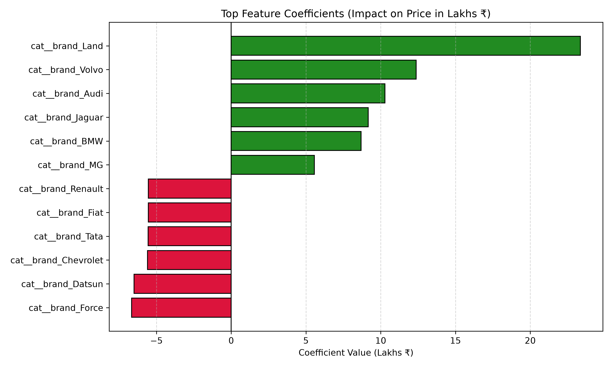

# 🚗 Used Car Price Prediction

> **AI101: Data Science and AI Essentials with Python — Mini-Project**  
> **Indian Institute of Technology Ropar (IIT Ropar)**

---

## 📌 Project Overview
This project develops an end-to-end Machine Learning pipeline to predict used car market selling prices using the **Car Dekho Used Cars Dataset**. 

Using vehicle attributes such as age, mileage, transmission type, fuel type, owner history, and brand equity, we engineer informative predictors, prevent data leakage via Scikit-Learn `Pipeline` and `ColumnTransformer` constructs, train a multiple linear regression model, and evaluate prediction performance with standard regression metrics.

---

## 📂 Repository Structure

```text
ai101-mini-project/
├── data/
│   └── CAR DETAILS FROM CAR DEKHO.csv      # Raw Car Dekho used cars dataset
├── output/
│   ├── actual_vs_predicted.png             # Actual vs Predicted evaluation plot
│   ├── feature_coefficients.png            # Top positive and negative coefficients
│   └── residual_distribution.png           # Residual error distribution plot
├── src/
│   └── main.py                             # Standalone command-line execution script
├── Used_Car_Price_Prediction.ipynb         # Interactive Jupyter Notebook walkthrough
├── requirements.txt                        # Required Python package dependencies
├── .gitignore                              # Git exclusion rules
└── README.md                               # Project documentation & execution guide
```

---

## ⚡ Quickstart & Execution Guide

### 1. Clone the Repository
```bash
git clone https://github.com/2026aib1001-AI/ai101-mini-project.git
cd ai101-mini-project
```

### 2. Set Up Virtual Environment (Recommended)
```bash
python3 -m venv .venv
source .venv/bin/activate      # On macOS/Linux
# .venv\Scripts\activate       # On Windows
```

### 3. Install Dependencies
```bash
pip install -r requirements.txt
```

### 4. Run the Pipeline from the Command Line
```bash
python src/main.py
```
> The script will clean the data, train the model, display all metrics in the terminal, and save/update the diagnostic charts in the `output/` folder.

### 5. (Optional) Run the Interactive Jupyter Notebook
```bash
jupyter notebook Used_Car_Price_Prediction.ipynb
```

---

## 🔬 Methodology & Pipeline Architecture

```text
Raw Data (4,340 rows)
   │
   ▼
[1] Data Cleaning ──► Deduplication (763 duplicate rows removed ➔ 3,577 unique rows)
   │
   ▼
[2] Feature Engineering:
       • age = 2020 - year
       • brand = first word of vehicle title
   │
   ▼
[3] Feature Selection:
       • Target (y) : selling_price
       • Numerics   : ['age', 'km_driven']
       • Categorical: ['fuel', 'seller_type', 'transmission', 'owner', 'brand']
       • Dropped    : 'name' (1,491 distinct titles ➔ severe overfitting) & 'year' (redundant)
   │
   ▼
[4] Train-Test Split ──► 80% Training (2,861 rows) / 20% Testing (716 rows) [random_state=42]
   │
   ▼
[5] ColumnTransformer:
       • Numeric Pipeline: Median Imputer + StandardScaler
       • Categorical Pipeline: Mode Imputer + OneHotEncoder (43 total dimensions)
   │
   ▼
[6] Linear Regression Model ──► Minimizes residual sum of squares
   │
   ▼
[7] Evaluation & Plot Generation ──► R², MAE, MSE, RMSE, and visual diagnostic exports
```

---

## 📊 Model Evaluation & Results

The model was evaluated on the held-out test set ($N = 716$ unseen cars):

| Metric | Training Set | Testing Set | Interpretation |
| :--- | :---: | :---: | :--- |
| **$R^2$ Score** | **0.6608** | **0.5405** | Explains ~54.1% of price variance on unseen data. |
| **Mean Absolute Error (MAE)** | — | **₹1,79,641.77** | Average prediction deviation from true market price. |
| **Mean Squared Error (MSE)** | — | **1.4801 × 10¹¹** | Average squared error. |
| **Root Mean Squared Error (RMSE)** | — | **₹3,84,722.70** | Penalizes larger valuation errors; reflects high-end luxury spread. |
| **Model Base Intercept** | — | **₹1,042,435.48** | Baseline reference value at centered/standardized features. |

---

## 📈 Visual Diagnostic Plots

All plots are automatically generated and saved by `src/main.py` inside the `output/` directory:

### 1. Actual vs. Predicted Selling Price
Compares true test set prices against model predictions. Points along the dashed red diagonal line ($y = x$) represent perfect predictions:


### 2. Residual Error Distribution
Displays the distribution of prediction residuals ($\text{Actual} - \text{Predicted}$). Centering around zero confirms unbiased estimation:


### 3. Top Feature Coefficients (Price Drivers)
Illustrates which vehicle characteristics produce the largest positive (premium) or negative (discount) impact on resale price:



---

## 💡 Key Business & Data Insights
1. **Age Depreciation**: Vehicle age is the strongest negative continuous driver ($\approx -₹1,50,690$ per standard deviation increase in age).
2. **Mileage Wear & Tear**: Kilometers driven moderately depresses price ($\approx -₹47,753$ per standard deviation increase).
3. **Transmission Premium**: Automatic transmission commands a substantial premium over manual counterparts.
4. **Brand Equity**: Luxury marques (Land Rover, Volvo, Audi, Jaguar, BMW) command significant premiums (+₹8.6L to +₹23.3L over baseline), while economy brands (Datsun, Force, Chevrolet) trade at notable discounts.

---

## 🛠️ Tech Stack & Requirements
- **Language**: Python 3.9+
- **Data Manipulation**: `pandas`, `numpy`
- **Machine Learning**: `scikit-learn` (`Pipeline`, `ColumnTransformer`, `StandardScaler`, `OneHotEncoder`, `LinearRegression`)
- **Data Visualization**: `matplotlib`
