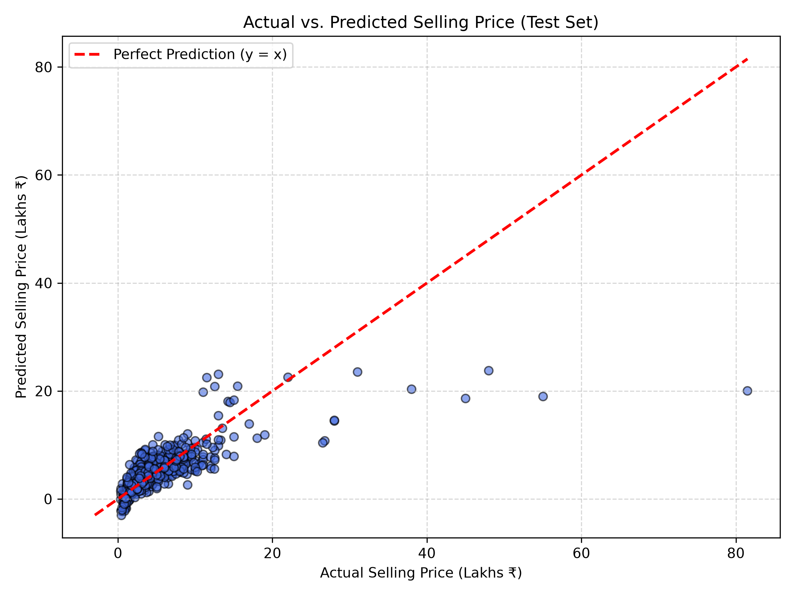
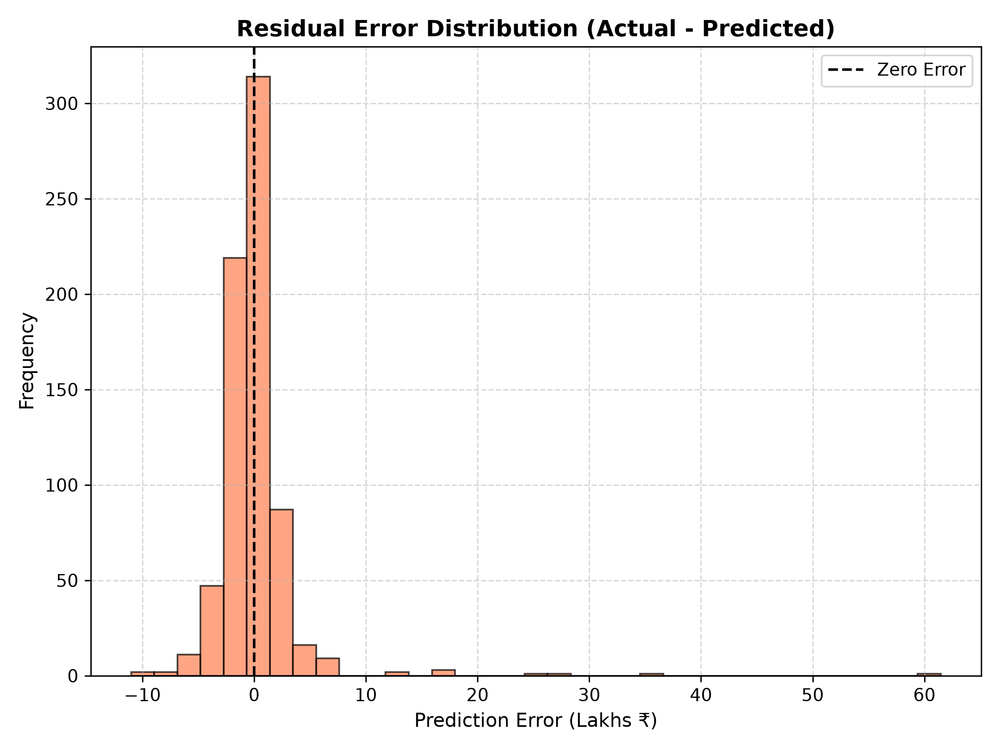
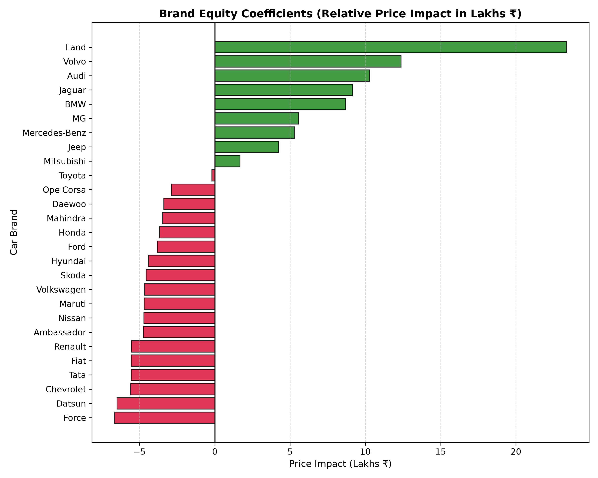
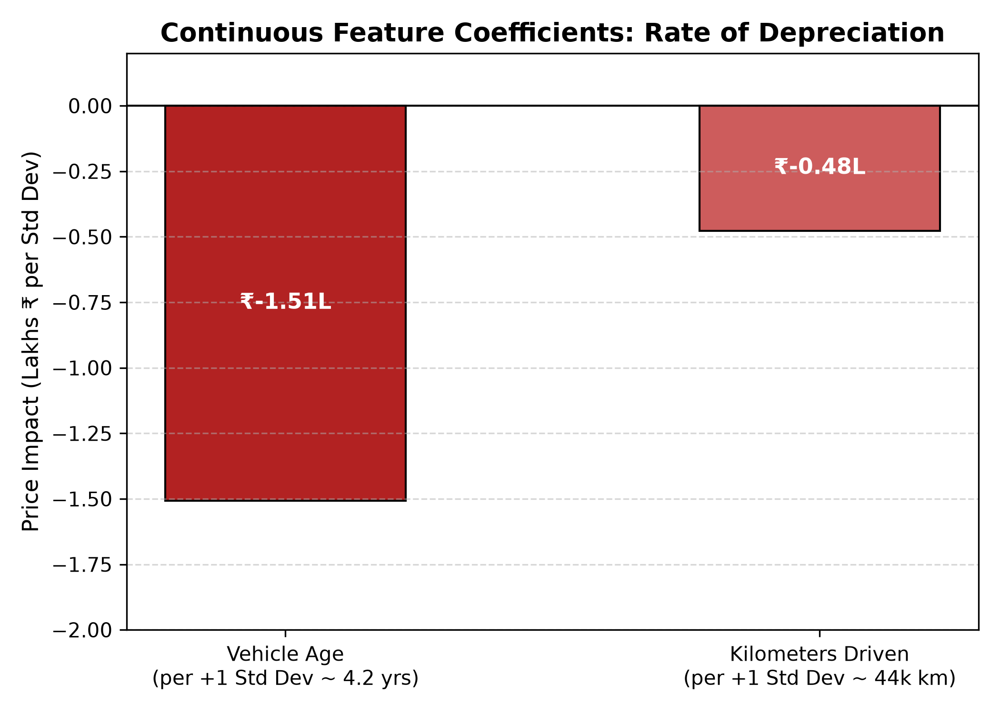
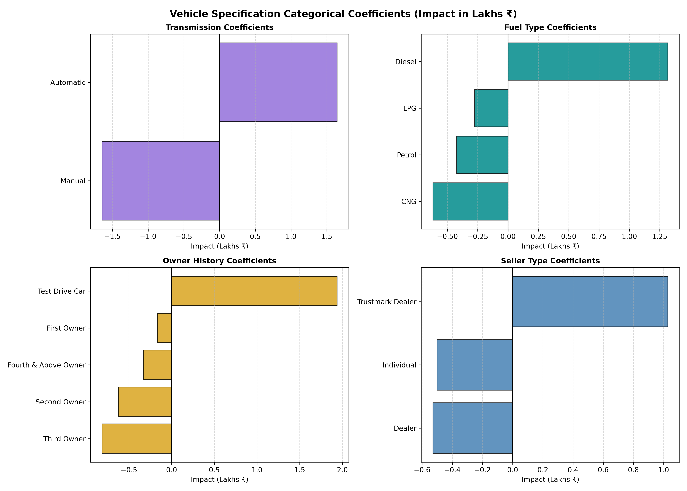

# 🚗 Used Car Price Prediction

> **AI101: Data Science and AI Essentials with Python — Mini-Project**  
> **Indian Institute of Technology Ropar (IIT Ropar)**

---

## 📌 Project Overview
This project develops an end-to-end Machine Learning pipeline to predict used car market selling prices using the **Car Dekho Used Cars Dataset**. 

Using vehicle attributes such as age, mileage, transmission type, fuel type, owner history, and brand equity, we engineer informative predictors, prevent data leakage via Scikit-Learn `Pipeline` and `ColumnTransformer` constructs, train a multiple linear regression model, and evaluate prediction performance with standard regression metrics.

---

## 📂 Repository Structure

```text
ai101-mini-project/
├── data/
│   └── CAR DETAILS FROM CAR DEKHO.csv      # Raw Car Dekho used cars dataset
├── output/
│   ├── actual_vs_predicted.png             # Actual vs Predicted evaluation plot
│   ├── residual_distribution.png           # Residual error distribution plot
│   ├── brand_coefficients.png              # Brand equity valuation coefficients
│   ├── numeric_coefficients.png            # Age & mileage depreciation coefficients
│   └── categorical_coefficients.png        # Transmission, Fuel, Owner, Seller subplots
├── src/
│   └── main.py                             # Standalone command-line execution script
├── Used_Car_Price_Prediction.ipynb         # Interactive Jupyter Notebook walkthrough
├── requirements.txt                        # Required Python package dependencies
├── .gitignore                              # Git exclusion rules
└── README.md                               # Project documentation & execution guide
```

---

## ⚡ Quickstart & Execution Guide

### 1. Clone the Repository
```bash
git clone https://github.com/2026aib1001-AI/ai101-mini-project.git
cd ai101-mini-project
```

### 2. Set Up Virtual Environment (Recommended)
```bash
python3 -m venv .venv
source .venv/bin/activate      # On macOS/Linux
# .venv\Scripts\activate       # On Windows
```

### 3. Install Dependencies
```bash
pip install -r requirements.txt
```

### 4. Run the Pipeline from the Command Line
```bash
python src/main.py
```
> The script will clean the data, train the model, display all metrics in the terminal, and save/update the diagnostic charts in the `output/` folder.

### 5. (Optional) Run the Interactive Jupyter Notebook
```bash
jupyter notebook Used_Car_Price_Prediction.ipynb
```

---

## 🔬 Methodology & Pipeline Architecture

```text
Raw Data (4,340 rows)
   │
   ▼
[1] Data Cleaning ──► Deduplication (763 duplicate rows removed ➔ 3,577 unique rows)
   │
   ▼
[2] Feature Engineering:
       • age = 2020 - year
       • brand = first word of vehicle title
   │
   ▼
[3] Feature Selection:
       • Target (y) : selling_price
       • Numerics   : ['age', 'km_driven']
       • Categorical: ['fuel', 'seller_type', 'transmission', 'owner', 'brand']
       • Dropped    : 'name' (1,491 distinct titles ➔ severe overfitting) & 'year' (redundant)
   │
   ▼
[4] Train-Test Split ──► 80% Training (2,861 rows) / 20% Testing (716 rows) [random_state=42]
   │
   ▼
[5] ColumnTransformer:
       • Numeric Pipeline: Median Imputer + StandardScaler
       • Categorical Pipeline: Mode Imputer + OneHotEncoder (43 total dimensions)
   │
   ▼
[6] Linear Regression Model ──► Minimizes residual sum of squares
   │
   ▼
[7] Evaluation & Plot Generation ──► R², MAE, MSE, RMSE, and visual diagnostic exports
```

---

## 📊 Model Evaluation & Results

The model was trained on $2,861$ instances and evaluated on $716$ unseen test cars ($80/20$ split):

| Metric | Training Set | Testing Set | Generalization Gap | Interpretation |
| :--- | :---: | :---: | :---: | :--- |
| **$R^2$ Score (Variance Explained)** | **0.6608** | **0.5405** | $-0.1203$ | Explains ~54.1% of variance on completely unseen data. |
| **Mean Absolute Error (MAE)** | **₹1,62,856.05** | **₹1,79,641.77** | $+₹16,785.72$ | Average prediction error is closely matched between train and test. |
| **Mean Squared Error (MSE)** | **8.2620 × 10¹⁰** | **1.4801 × 10¹¹** | $+6.5392 \times 10^{10}$ | Heavily penalizes luxury car outliers in the test fold. |
| **Root Mean Squared Error (RMSE)** | **₹2,87,436.88** | **₹3,84,722.70** | $+₹97,285.82$ | Standard deviation of residual prediction errors. |
| **Model Base Intercept** | — | **₹1,042,435.48** | — | Baseline reference price at mean/standardized feature values. |

> **Key Observation:** The close agreement between Training MAE (₹1.62L) and Testing MAE (₹1.79L) confirms that the model avoids severe overfitting and generalizes well to unseen used cars.

---

## 📈 Visual Diagnostic Plots

All plots are automatically generated and saved by `src/main.py` in the `output/` directory:

### 1. Actual vs. Predicted Selling Price
Compares true test set prices against model predictions. Points along the dashed red diagonal line ($y = x$) represent perfect predictions:



### 2. Residual Error Distribution
Displays the distribution of prediction residuals ($\text{Actual} - \text{Predicted}$). Centering around zero confirms an unbiased linear estimator:



### 3. Brand Equity Coefficients (All 27 Brands)
Demonstrates the massive impact of brand perception. Luxury marques (Land Rover, Volvo, Audi, Jaguar, BMW) command multi-lakh premiums, whereas budget-oriented brands experience relative resale discounts:



### 4. Continuous Feature Depreciation (Age vs. Mileage)
Directly compares the rate of depreciation caused by vehicle aging versus odometer mileage per standard deviation:
- **Vehicle Age**: Drops price by **~₹1,50,690** per 1 standard deviation (~4.2 years).
- **Kilometers Driven**: Drops price by **~₹47,754** per 1 standard deviation (~44,000 km).



### 5. Vehicle Specification Attributes (Transmission, Fuel, Owner, Seller)
Subplots detailing how specific mechanical and ownership features influence valuation:
- **Transmission**: Automatic cars command a substantial premium over manual models.
- **Fuel Type**: Diesel vehicles command higher market values than Petrol or CNG alternatives.
- **Ownership**: First-owner cars maintain superior resale value compared to multi-owner vehicles.



---

## 💡 Key Business & Data Insights
1. **Age vs. Mileage**: Car age depreciates vehicle value more than three times as rapidly as odometer mileage.
2. **Transmission Premium**: Automatic gearboxes significantly elevate secondary market prices.
3. **Brand Stratification**: Brand equity is the single most dominant driver in the dataset, with premium European brands commanding up to ₹23.3L over baseline.

---

## 🔬 Limitations & Future Scope (Undergrad Research Notes)

While our linear regression model achieves a solid baseline ($R^2 \approx 0.54$, Test MAE ₹1.79L), analyzing the residual errors revealed a few clear ways this project could be improved:

1. **Target Log-Transformation ($\log(\text{price})$)**:
   - *Observation:* Car prices in this dataset range from ₹35,000 to ₹89 Lakhs. A ₹2 Lakh error on an ₹80L BMW is negligible (2.5%), but that same ₹2 Lakh error on a ₹1.5L Maruti completely ruins the prediction.
   - *Improvement:* Training on $\ln(\text{price})$ instead of raw Rupees would optimize for relative percentage error, treating budget and luxury cars with equal fairness.

2. **Non-Linear Depreciation Curves (Tree Models)**:
   - *Observation:* Linear regression assumes a car loses the exact same rupee value every single year. In reality, cars lose value rapidly in years 1–3, but the depreciation curve flattens out after year 7 or 8.
   - *Improvement:* Testing **Random Forest** or **Decision Tree Regressors** would capture this natural decay curve without requiring complex polynomial features.

3. **Driving Intensity Feature ($\text{km} / \text{age}$)**:
   - *Observation:* A 6-year-old car with 60,000 km is a normal family car (10,000 km/yr). A 2-year-old car with 60,000 km was probably driven hard as a commercial taxi (30,000 km/yr). Currently, our model only sees "60,000 km" and cannot tell them apart.
   - *Improvement:* Adding an engineered feature like `km_per_year = km_driven / (age + 1)` would directly flag heavily used fleet vehicles.

4. **Grouping Rare Brands into Tiers**:
   - *Observation:* We currently create 27 one-hot encoded brand columns, but brands like *Force*, *Daewoo*, or *Ambassador* appear only 1 to 3 times in the entire dataset.
   - *Improvement:* Grouping brands into simple tiers (*Luxury*, *Mid-Range*, *Budget*) would reduce column clutter and make predictions for rare brands much more reliable.

5. **Extracting Engine Size & Trim from Car Name**:
   - *Observation:* We dropped the `name` column because 1,491 distinct car names caused overfitting. But strings like *"Verna 1.6 SX"* or *"Swift VDI"* contain engine size (1.6L vs 1.2L) and top-end trim info that buyers pay extra for.
   - *Improvement:* Using basic string splitting or regex to pull out engine displacement (`cc`) and trim levels into separate numeric features.

---

## 🛠️ Tech Stack & Requirements
- **Language**: Python 3.9+
- **Data Manipulation**: `pandas`, `numpy`
- **Machine Learning**: `scikit-learn` (`Pipeline`, `ColumnTransformer`, `StandardScaler`, `OneHotEncoder`, `LinearRegression`)
- **Data Visualization**: `matplotlib`

---

## 👥 Project Team

Developed as part of the **AI101: Data Science and AI Essentials with Python** course at **IIT Ropar**:

| # | Team Member | Entry Number | Role & Responsibilities |
| :---: | :--- | :---: | :--- |
| 1 | **Siddharth Kumar** | `2026DAB1307` | **Execution & Setup Lead** |
| 2 | **Nihal Ahirwar** | `2026EEB1385` | **Data Analyst & Documentation Lead** |
| 3 | **Divyaans Agarwal** | `2026MCB1696` | **Integration & Video Lead** |
| 4 | **A Damaruk Vajra Tej** | `2026AIB1001` | **Evaluation & PPT Lead** |

